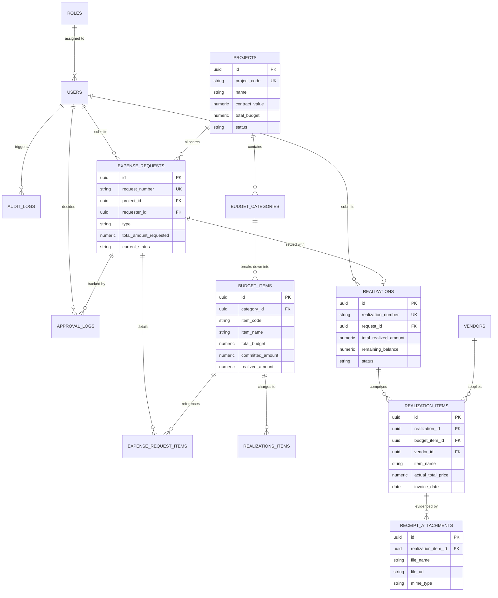
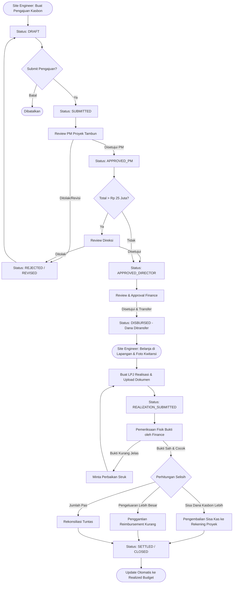

# FASE 1: SYSTEM ARCHITECTURE & INTEGRATION BLUEPRINT
## Aplikasi Monitoring Pembelanjaan Proyek (Realisasi Dana Proyek Tambun)

---

## 1. Executive Summary & Objektif Sistem

Sistem **Monitoring Pembelanjaan Proyek** dirancang untuk mencatat, mengontrol, dan memantau realisasi anggaran proyek konstruksi/lapangan secara *real-time*. Tantangan utama dalam pengelolaan dana proyek lapangan meliputi:
1. **Budget Overrun**: Pembelian barang/jasa melebihi pagu Rencana Anggaran Biaya (RAB/WBS).
2. **Keterlambatan LPJ & Bukti Fisik**: Bukti nota/kwitansi tercecer atau terlambat diverifikasi dari lapangan ke finance kantor pusat.
3. **Penyalahgunaan Kas Bon (Cash Advance)**: Ketiadaan rekonsiliasi antara dana yang ditarik dengan realisasi belanja fisik di lapangan.
4. **Blindspot Manajemen**: Direksi dan PM kesulitan melihat *variance* (RAB vs Aktual) dan sisa pagu proyek tanpa menunggu laporan bulanan manual.

Dokumen ini menjadi fondasi arsitektur terpadu sebelum implementasi kode dimulai.

---

## 2. Rekomendasi Tech Stack Terpadu

Kombinasi teknologi dirancang dengan prinsip: **Type Safety End-to-End**, **Financial Data Integrity**, **Responsivitas Lapangan (Mobile-friendly)**, dan **Modularitas Skalabilitas Tinggi**.

```
+--------------------------------------------------------------------------+
|                            FRONTEND CLIENT                               |
|   Next.js (App Router) + Tailwind CSS + shadcn/ui + Lucide Icons         |
|   State: TanStack Query v5 (Server Cache) + Zustand (Client UI State)    |
+--------------------------------------------------------------------------+
                                     |
                                REST API / HTTP (JSON / FormData)
                                     v
+--------------------------------------------------------------------------+
|                            BACKEND RUNTIME                               |
|   NestJS (Node.js LTS / TypeScript) - Modular Clean Architecture         |
|   Auth & Security: Passport JWT, RBAC Guards, Helmet, Zod / Class-Val    |
+--------------------------------------------------------------------------+
                                     |
                                Prisma ORM
                                     v
+----------------------------------+---------------------------------------+
|         DATABASE ENGINE          |            OBJECT STORAGE             |
|   PostgreSQL 16+ (ACID, Decimal) |   MinIO / AWS S3 Compatible           |
|   Transaction Safe, Row Locking  |   (Penyimpanan Kwitansi, Nota, PDF)   |
+----------------------------------+---------------------------------------+
```

### 2.1 Backend Runtime: **NestJS (Node.js LTS + TypeScript)**
- **Alasan Pemilihan**:
  - Arsitektur berbasis *Module*, *Controller*, dan *Service* dengan *Dependency Injection* bawaan sangat cocok untuk modul finansial yang membutuhkan batasan domain yang tegas.
  - Dukungan kuat untuk *Guards* dan *Interceptors* guna menegakkan RBAC dan pencatatan audit log otomatis tanpa merusak logika bisnis.
  - Integrasi native dengan Prisma ORM untuk menjamin transaksi finansial bersifat ACID (`prisma.$transaction`).

### 2.2 Database Engine: **PostgreSQL 16+**
- **Alasan Pemilihan**:
  - **Tipe Data `NUMERIC(15, 2)`**: Menghindari *floating-point rounding error* pada kalkulasi rupiah/pajak/diskon.
  - **ACID Compliant & Row-Level Locking (`FOR UPDATE`)**: Mencegah *race condition* saat dua kasir/admin memotong pagu anggaran yang sama secara paralel.
  - **JSONB Capability**: Menyimpan riwayat perubahan snapshot data audit (*audit trail*) dan metadata fleksibel tanpa perlu menambah tabel berlebih.

### 2.3 Frontend Framework: **Next.js (App Router / React 19) + Tailwind CSS + shadcn/ui**
- **Alasan Pemilihan**:
  - **Responsif & Multi-device**: Digunakan oleh Site Engineer di lapangan via HP/tablet (kamera untuk foto nota) dan oleh Finance/Direksi via desktop (tabel data besar, visualisasi grafik).
  - **Ekosistem UI Modern (shadcn/ui & TanStack Table)**: Mendukung fitur filtering kompleks, virtualized table untuk ribuan item pengeluaran, pagination server-side, serta visual modal formulir pengajuan dana yang intuitif.

### 2.4 State Management: **TanStack Query v5 + Zustand**
- **TanStack Query (Server State)**:
  - Mengelola *caching*, *optimistic updates*, *background revalidation*, dan status mutasi pengajuan dana.
  - Meniadakan boilerplate penanganan `isLoading`, `isError`, dan *cache invalidation* setelah approval atau upload kwitansi.
- **Zustand (Client UI State)**:
  - Menyimpan state filter tabel multi-kriteria, status modal popup, keranjang item pengajuan belanja sementara sebelum *submit*, serta state collapsed sidebar.

### 2.5 Media & Storage Engine: **S3-Compatible Storage (MinIO / Supabase / Cloudflare R2)**
- Menyimpan berkas bukti pembayaran (foto struk thermal, nota toko, surat jalan, invoice vendor, berita acara). Database hanya menyimpan URL dan checksum integritas berkas.

---

## 3. Entity Relationship Blueprint (Data Modeling)

Struktur data dibagi ke dalam 4 domain utama:
1. **Master & Access Control** (`users`, `roles`, `audit_logs`)
2. **Project & Budget Definition (RAB)** (`projects`, `budget_categories`, `budget_items`)
3. **Pengajuan Dana (Cash Advance & PO)** (`expense_requests`, `expense_request_items`, `approval_logs`)
4. **Realisasi Belanja & LPJ** (`realizations`, `realization_items`, `receipt_attachments`, `vendors`)

### 3.1 Spesifikasi Entitas & Skema Relasi

#### A. Domain Master & Otentikasi
1. `roles`
   - `id` (PK, UUID)
   - `name` (VARCHAR(50), UNIQUE) — *SUPERADMIN, PROJECT_MANAGER, SITE_ENGINEER, FINANCE, DIRECTOR*
   - `description` (TEXT)
   - `created_at` (TIMESTAMPTZ)
2. `users`
   - `id` (PK, UUID)
   - `role_id` (FK -> `roles.id`)
   - `name` (VARCHAR(100))
   - `email` (VARCHAR(150), UNIQUE)
   - `password_hash` (VARCHAR(255))
   - `phone` (VARCHAR(20))
   - `is_active` (BOOLEAN, DEFAULT true)
   - `created_at`, `updated_at` (TIMESTAMPTZ)
3. `audit_logs`
   - `id` (PK, UUID)
   - `user_id` (FK -> `users.id`, NULLABLE untuk system actions)
   - `action` (VARCHAR(50)) — *CREATE, UPDATE, DELETE, APPROVE, REJECT, DISBURSE*
   - `entity` (VARCHAR(50)) — *PROJECT, EXPENSE_REQUEST, REALIZATION, etc.*
   - `entity_id` (UUID)
   - `old_values` (JSONB)
   - `new_values` (JSONB)
   - `ip_address` (VARCHAR(45))
   - `created_at` (TIMESTAMPTZ)

#### B. Domain Proyek & Anggaran (RAB / WBS)
4. `projects`
   - `id` (PK, UUID)
   - `project_code` (VARCHAR(50), UNIQUE) — e.g. "PRJ-TBN-2026-001"
   - `name` (VARCHAR(200)) — "Pembangunan Fasilitas Tambun"
   - `location` (TEXT)
   - `client_name` (VARCHAR(150))
   - `contract_value` (NUMERIC(15, 2))
   - `total_budget` (NUMERIC(15, 2))
   - `start_date` (DATE)
   - `end_date` (DATE)
   - `status` (ENUM: *PLANNING, ACTIVE, ON_HOLD, COMPLETED*)
   - `created_at`, `updated_at` (TIMESTAMPTZ)
5. `budget_categories` (WBS Tingkat 1)
   - `id` (PK, UUID)
   - `project_id` (FK -> `projects.id`, ON DELETE CASCADE)
   - `category_code` (VARCHAR(20)) — e.g. "WBS-01", "WBS-02"
   - `name` (VARCHAR(150)) — e.g. "Pekerjaan Struktur & Tanah", "Peralatan & BBM"
   - `allocated_amount` (NUMERIC(15, 2))
6. `budget_items` (RAB Detail / Akun Anggaran)
   - `id` (PK, UUID)
   - `category_id` (FK -> `budget_categories.id`, ON DELETE CASCADE)
   - `item_code` (VARCHAR(50), UNIQUE per project) — e.g. "MAT-SMN-01"
   - `item_name` (VARCHAR(200)) — e.g. "Semen Padang 50kg"
   - `unit` (VARCHAR(20)) — "ZAK", "M3", "LITER", "LS"
   - `unit_price` (NUMERIC(15, 2))
   - `quantity` (NUMERIC(12, 2))
   - `total_budget` (NUMERIC(15, 2)) — generated/computed `quantity * unit_price`
   - `committed_amount` (NUMERIC(15, 2), DEFAULT 0) — dana yang sudah di-approve dalam kasbon berjalan
   - `realized_amount` (NUMERIC(15, 2), DEFAULT 0) — dana yang sudah sah terealisasi via LPJ

#### C. Domain Pengajuan Dana (Expense Requests / Kas Bon)
7. `expense_requests`
   - `id` (PK, UUID)
   - `request_number` (VARCHAR(50), UNIQUE) — e.g. "REQ-202611-001"
   - `project_id` (FK -> `projects.id`)
   - `requester_id` (FK -> `users.id`)
   - `type` (ENUM: *CASH_ADVANCE, DIRECT_PURCHASE, REIMBURSEMENT*)
   - `title` (VARCHAR(255)) — e.g. "Kas Bon Pembelian Material Besi & Kawat Tambun"
   - `total_amount_requested` (NUMERIC(15, 2))
   - `current_status` (ENUM: *DRAFT, SUBMITTED, APPROVED_PM, APPROVED_FINANCE, REJECTED, DISBURSED, SETTLED*)
   - `need_by_date` (DATE)
   - `disbursed_at` (TIMESTAMPTZ, NULLABLE)
   - `notes` (TEXT)
   - `created_at`, `updated_at` (TIMESTAMPTZ)
8. `expense_request_items`
   - `id` (PK, UUID)
   - `request_id` (FK -> `expense_requests.id`, ON DELETE CASCADE)
   - `budget_item_id` (FK -> `budget_items.id`)
   - `description` (TEXT)
   - `requested_qty` (NUMERIC(12, 2))
   - `estimated_unit_price` (NUMERIC(15, 2))
   - `estimated_total` (NUMERIC(15, 2))
9. `approval_logs`
   - `id` (PK, UUID)
   - `request_id` (FK -> `expense_requests.id`)
   - `approver_id` (FK -> `users.id`)
   - `stage` (ENUM: *PM_APPROVAL, FINANCE_APPROVAL, DIRECTOR_APPROVAL*)
   - `decision` (ENUM: *APPROVED, REJECTED, REVISION_REQUESTED*)
   - `comment` (TEXT)
   - `decided_at` (TIMESTAMPTZ)

#### D. Domain Realisasi & Bukti Fisik (Settlement / LPJ)
10. `vendors`
    - `id` (PK, UUID)
    - `name` (VARCHAR(150))
    - `phone` (VARCHAR(30))
    - `address` (TEXT)
    - `bank_name` (VARCHAR(50))
    - `bank_account_number` (VARCHAR(50))
    - `npwp` (VARCHAR(30), NULLABLE)
11. `realizations` (Laporan Pertanggungjawaban Belanja / Settlement)
    - `id` (PK, UUID)
    - `realization_number` (VARCHAR(50), UNIQUE) — e.g. "RLZ-202611-001"
    - `request_id` (FK -> `expense_requests.id`, UNIQUE 1:1)
    - `submitted_by` (FK -> `users.id`)
    - `total_realized_amount` (NUMERIC(15, 2))
    - `remaining_balance` (NUMERIC(15, 2)) — `total_amount_requested - total_realized_amount` (Sisa Kasbon kembali / Reimburse kurang)
    - `status` (ENUM: *DRAFT, SUBMITTED, VERIFIED_FINANCE, REJECTED, COMPLETED*)
    - `settled_at` (TIMESTAMPTZ, NULLABLE)
    - `notes` (TEXT)
    - `created_at`, `updated_at` (TIMESTAMPTZ)
12. `realization_items`
    - `id` (PK, UUID)
    - `realization_id` (FK -> `realizations.id`, ON DELETE CASCADE)
    - `budget_item_id` (FK -> `budget_items.id`)
    - `vendor_id` (FK -> `vendors.id`, NULLABLE)
    - `item_name` (VARCHAR(200))
    - `actual_qty` (NUMERIC(12, 2))
    - `actual_unit_price` (NUMERIC(15, 2))
    - `actual_total_price` (NUMERIC(15, 2))
    - `invoice_date` (DATE)
    - `notes` (TEXT)
13. `receipt_attachments`
    - `id` (PK, UUID)
    - `realization_item_id` (FK -> `realization_items.id`, ON DELETE CASCADE)
    - `file_name` (VARCHAR(255))
    - `file_url` (TEXT)
    - `file_size_bytes` (INTEGER)
    - `mime_type` (VARCHAR(50)) — *image/jpeg, image/png, application/pdf*
    - `uploaded_at` (TIMESTAMPTZ)

---

### 3.2 Mermaid Entity Relationship Diagram



---

## 4. Matriks Hak Akses / Role-Based Access Control (RBAC)

Sistem membedakan wewenang secara hierarkis dan fungsional ke dalam 5 peran:
1. **Superadmin (SA)**: Pengelola sistem, user, konfigurasi server, & audit log.
2. **Project Manager (PM)**: Penanggung jawab teknis proyek Tambun, verifikator pengajuan lapangan, pengawas realisasi vs RAB.
3. **Site Engineer / Pelaksana (SE)**: Pengaju kasbon, pelaku pembelanjaan harian di lapangan, pengunggah kwitansi/LPJ.
4. **Finance & Accounting (FA)**: Pemeriksa keabsahan bukti struk, approval keuangan, pencairan kasbon, dan rekonsiliasi kas.
5. **Direktur / Management (DR)**: Monitoring laporan eksekutif, *high-value expense approval* (> threshold tertentu, misal > Rp 25.000.000).

### 4.1 Permission Matrix Table

| Modul & Aksi | Superadmin | Project Manager | Site Engineer | Finance & Acct | Direktur |
| :--- | :---: | :---: | :---: | :---: | :---: |
| **Manajemen User & Role** | CRUD | View Only | No Access | No Access | View Only |
| **Audit Logs Viewer** | Full | No Access | No Access | Read Only | Read Only |
| **Master Proyek & RAB** | CRUD | Read / Propose Edit | Read Only | Read Only | Approve / Read |
| **Buat Pengajuan Dana (Kasbon)** | Create/Edit | Create/Edit | **Create/Edit (Utama)** | Create (Petty Cash) | No Access |
| **Approval Tahap 1 (PM Review)** | Bypass | **Approve / Reject** | No Access | No Access | No Access |
| **Approval Tahap 2 (Finance)** | Bypass | No Access | No Access | **Approve / Reject** | No Access |
| **Approval Tahap 3 (Direksi > 25jt)**| Bypass | No Access | No Access | Review & Forward | **Approve / Reject** |
| **Pencairan Dana (Disbursement)** | No Access | No Access | No Access | **Execute (Disburse)** | View Only |
| **Input Realisasi & Upload Struk**| Create/Edit | Review | **Create / Upload** | No Access | View Only |
| **Verifikasi Bukti Struk/Kwitansi** | View Only | Technical Check | No Access | **Legal/Tax Verify** | View Only |
| **Closing LPJ (Settlement)** | Bypass | Recommend | No Access | **Final Settlement** | View Only |
| **Dashboard Executive & Analisis**| Full | Project Scope | Lapangan Scope | Financial Scope | **Full Executive** |
| **Export Excel / PDF Laporan** | Yes | Yes | Yes (Draft LPJ) | Yes (Full Laporan) | Yes (Executive) |

---

### 4.2 Siklus Alur Pengajuan Dana & Realisasi (State Transition)



---

## 5. Struktur Folder Monorepo / Modular Terpadu

Menggunakan pendekatan **Monorepo (pnpm workspace + Turborepo)**. Pendekatan ini memungkinkan *backend* dan *frontend* berbagi tipe data (TypeScript Interfaces), skema validasi (Zod Schemas), dan enum status secara identik tanpa redundansi kode.

```
REALISASI DANA PROJECT TAMBUN/
├── .github/
│   └── workflows/                # CI/CD pipeline (lint, typecheck, build)
├── apps/
│   ├── api/                      # BACKEND (NestJS Application)
│   │   ├── src/
│   │   │   ├── common/           # Interceptors, filters, decorators, guards
│   │   │   │   ├── decorators/   # @CurrentUser(), @Roles()
│   │   │   │   ├── guards/       # JwtAuthGuard, RolesGuard
│   │   │   │   └── interceptors/ # AuditLogInterceptor, TransformResponseInterceptor
│   │   │   ├── config/           # App, Database, Storage, JWT configurations
│   │   │   ├── modules/          # Business Domain Modules
│   │   │   │   ├── auth/         # Login, Refresh Token, Profile
│   │   │   │   ├── users/        # User CRUD & Role assignments
│   │   │   │   ├── projects/     # Project & WBS Category Management
│   │   │   │   ├── budgets/      # Budget items, committed/realized balance calculations
│   │   │   │   ├── requests/     # Expense requests, cash advances, workflow engine
│   │   │   │   ├── realizations/ # Realization LPJ, itemizing actual costs
│   │   │   │   ├── attachments/  # Upload handler, S3/MinIO presigned URLs, MIME validation
│   │   │   │   ├── vendors/      # Vendor master directory
│   │   │   │   └── analytics/    # Variance analysis, burn-rate, export PDF/Excel
│   │   │   ├── app.module.ts
│   │   │   └── main.ts
│   │   ├── test/                 # E2E & unit tests
│   │   ├── package.json
│   │   └── tsconfig.json
│   │
│   └── web/                      # FRONTEND (Next.js 14/15 App Router)
│       ├── public/               # Static assets & brand logos
│       ├── src/
│       │   ├── app/              # App Router Pages
│       │   │   ├── (auth)/       # Login, Forgot Password layout
│       │   │   ├── (dashboard)/  # Authenticated Layout (Sidebar, Topbar)
│       │   │   │   ├── dashboard/       # Main overview metrics (Burn rate, Overrun alerts)
│       │   │   │   ├── projects/        # Project & RAB details
│       │   │   │   ├── requests/        # Pengajuan Kasbon (List, New Form, Approval flow)
│       │   │   │   ├── realizations/    # LPJ & Bukti Belanja (Upload struk, OCR preview)
│       │   │   │   ├── vendors/         # Vendor catalog
│       │   │   │   ├── reports/         # Laporan Realisasi vs RAB, Export Center
│       │   │   │   └── settings/        # User management, Role settings, Audit Trail
│       │   │   ├── api/          # Next.js API route handlers / proxy if needed
│       │   │   ├── layout.tsx
│       │   │   └── page.tsx
│       │   ├── components/       # UI Components
│       │   │   ├── ui/           # Atomic shadcn/ui (Button, Dialog, Table, Form, Input, etc.)
│       │   │   ├── forms/        # Domain forms (ExpenseRequestForm, RealizationForm, FileUpload)
│       │   │   ├── tables/       # TanStack Table implementations with pagination & filters
│       │   │   └── charts/       # Recharts / Visx visual components (S-Curve, Budget vs Actual)
│       │   ├── hooks/            # Custom hooks (useAuth, usePermission, useDebounce)
│       │   ├── lib/              # Client utilities, Axios/Fetch instance, formatters (Rupiah, Date)
│       │   └── stores/           # Zustand client stores (UI state, draft submission cache)
│       ├── package.json
│       └── tsconfig.json
│
├── packages/
│   ├── database/                 # DATABASE & ORM LAYER
│   │   ├── prisma/
│   │   │   ├── schema.prisma     # Definisi model database terpusat
│   │   │   ├── migrations/       # Riwayat migration database
│   │   │   └── seeds/            # Data inisialisasi (Superadmin, Roles, Akun RAB Awal Tambun)
│   │   ├── src/
│   │   │   └── index.ts          # Export PrismaClient singleton
│   │   └── package.json
│   │
│   ├── shared/                   # DTOs, CONTRACTS, VALIDATION SCHEMAS
│   │   ├── src/
│   │   │   ├── enums/            # RoleEnum, RequestStatusEnum, RealizationStatusEnum
│   │   │   ├── schemas/          # Zod schemas (ExpenseRequestSchema, RealizationItemSchema)
│   │   │   ├── types/            # TypeScript interfaces & API response contracts
│   │   │   └── index.ts
│   │   └── package.json
│   │
│   ├── config/                   # ESLint, Prettier, TypeScript base configs
│   │   ├── eslint-preset.js
│   │   └── tsconfig.base.json
│   │
│   └── ui-theme/                 # Shared Tailwind design tokens (colors, radii, typography)
│       ├── tailwind.config.js
│       └── package.json
│
├── docs/                         # DOKUMENTASI SISTEM & ARSITEKTUR
│   ├── FASE-1-SYSTEM-ARCHITECTURE-BLUEPRINT.md
│   └── api-specs.md
│
├── docker-compose.yml            # PostgreSQL, MinIO, pgAdmin untuk local development
├── pnpm-workspace.yaml           # Definisi modular workspace
├── turbo.json                    # Pipeline build cache & orchestration
└── package.json                  # Root scripts
```

---

## 6. Validasi Risiko Teknis & Strategi Mitigasi

| Risiko Potensial | Dampak | Mitigasi Arsitektur |
| :--- | :--- | :--- |
| **Ukuran Berkas Struk Terlalu Besar** | Server lambat & kuota storage membengkak | Kompresi otomatis di sisi browser (WebP/JPEG client resize) sebelum upload, dengan batas maksimal 5MB. |
| **Koneksi Internet Lapangan Tidak Stabil** | Site Engineer gagal upload kwitansi di lokasi Tambun | Implementasi form *offline draft* via local storage / IndexedDB, upload otomatis dilanjutkan ketika koneksi kembali online. |
| **Perubahan Harga / Inflasi Material Lapangan** | Selisih tajam antara RAB vs Nota Realisasi | Sistem peringatan dini (*Early Warning Indicator*): Flag kuning jika harga item melampaui toleransi 5-10% dari harga satuan RAB, butuh *justification note*. |
| **Double Spending / Pengeluaran Dobel** | Pembayaran ganda untuk kwitansi yang sama | Hash checksum berkas struk dan validasi nomor faktur vendor unik per vendor. |

---

## 7. Rencana Tahapan Selanjutnya (Next Steps)

Setelah dokumen arsitektur ini ditinjau dan disetujui:
- **Fase 2**: Penyiapan Monorepo workspace (`pnpm-workspace`, `turbo.json`), Skema Database (`schema.prisma`) lengkap dengan seed role & akun awal proyek Tambun, dan migrasi PostgreSQL.
- **Fase 3**: Implementasi Backend Core (`apps/api`) meliputi autentikasi JWT, RBAC Guard, CRUD Proyek & RAB, alur pengajuan dana, serta *upload engine*.
- **Fase 4**: Implementasi Frontend Dashboard & Form Mobile Lapangan (`apps/web`) dengan komponen form pengajuan belanja, upload foto kwitansi, dan tabel approval.
- **Fase 5**: Pengujian Terpadu (*E2E testing* alur kasbon hingga settlement), audit trail, dan visualisasi grafik perbandingan RAB vs Realisasi.
